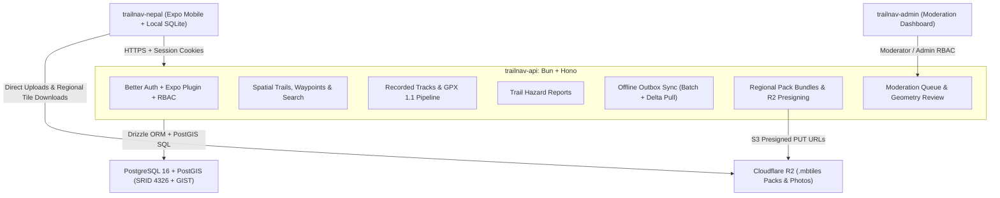

# TrailNav Nepal API

Geospatial REST API and offline-first sync backend for **TrailNav Nepal** — a high-altitude trekking navigation platform built for low-connectivity Himalayan regions (Annapurna, Khumbu/EBC, Langtang, Manaslu, and Ghorepani Poon Hill).

Built with **Bun**, **Hono**, **PostgreSQL + PostGIS**, **Drizzle ORM**, **Better Auth** (with `@better-auth/expo`), **Cloudflare R2**, **Arcjet**, and **Scalar OpenAPI**.

---

## Architecture



### Core Capabilities

- **PostGIS Spatial Engine**: Stores routes as `GEOMETRY(LineStringZM, 4326)`, waypoints as `GEOMETRY(PointZ, 4326)`, and hazard reports as `GEOMETRY(Point, 4326)` with GIST spatial indexes supporting `ST_Intersects(ST_MakeEnvelope(...))`, `ST_DWithin`, `ST_Distance`, and `ST_SimplifyPreserveTopology`.
- **Offline-First Two-Way Sync**: Processes batched mobile SQLite outbox events (`recorded_track`, `safety_report`, `waypoint_photo`) idempotently via `sync_events.client_event_id`, isolating malformed records and detecting ownership/version conflicts, paired with timestamped delta pulls (`GET /api/v1/sync/pull`).
- **GPX 1.1 & Himalayan Elevation Analysis**: Parses and serializes GPX 1.1 XML (`<trkpt>`, `<wpt>`, `<ele>`, `<time>`), calculates Haversine distances and `>3m` deadband-filtered elevation gain/loss, and flags abrupt GPS altitude spikes for ranger moderation.
- **Regional Offline Tile Packs & Cloudflare R2 Media**: Serves versioned regional pack catalogs (`poon-hill`, `annapurna-circuit`, `khumbu-ebc`, `langtang-valley`, `manaslu-circuit`), one-shot SQLite hydration bundles, and MIME/size-validated presigned R2 PUT URLs.
- **Expo Authentication & RBAC**: Configures Better Auth with `@better-auth/expo` (`trailnav://` trusted scheme) and role-based middleware (`trekker`, `moderator`, `admin`).
- **Security & Observability**: Per-route Arcjet WAF and rate limiting, structured Pino logs with request correlation IDs, Zod request validation, and interactive Scalar OpenAPI docs at `/docs`.

---

## API Overview

Interactive OpenAPI 3 documentation is served at `/docs` (`/openapi.json`).

### Authentication & Profile
- `GET/POST /api/auth/*` — Better Auth session, sign-up, and sign-in handlers (web + Expo)
- `GET /api/v1/users/me` — Authenticated user profile
- `PATCH /api/v1/users/me` — Update display name or avatar URL
- `GET /api/v1/users/me/stats` — Cumulative distance, elevation gain, max altitude, tracks, and hazard reports

### Trails, Waypoints & Search
- `GET /api/v1/trails` — Filter by `region`, `difficulty`, `status`, `packRegionId`, `q`, `bbox=west,south,east,north`, `lat`/`lon`/`radiusKm`, optional `includeGeom=true` & `simplifyTolerance`
- `GET /api/v1/trails/:idOrSlug` — Full `LineStringZM` geometry, trail waypoints, and active hazards
- `GET /api/v1/trails/:idOrSlug/gpx` — Download trail and waypoints as GPX 1.1 XML
- `POST /api/v1/trails` — Submit a community trail (`community_pending` for trekkers, `verified` for moderators/admins)
- `GET /api/v1/waypoints/nearby` — PostGIS `ST_DWithin` + `ST_Distance` lookup for nearest teahouses, water sources, passes, and viewpoints
- `GET /api/v1/search` — Unified search across trails and waypoints

### Recorded Tracks & GPX Pipeline
- `GET /api/v1/tracks` — List authenticated user's recorded tracks
- `GET /api/v1/tracks/:id` — Retrieve single track with `LineStringZM` geometry
- `POST /api/v1/tracks` — Save recorded track (optional `submitForCommunityReview` promotion)
- `POST /api/v1/tracks/import-gpx` — Import GPX 1.1 XML with automatic distance, deadband elevation, and spike analysis
- `GET /api/v1/tracks/:id/gpx` — Export recorded track as GPX 1.1 XML
- `DELETE /api/v1/tracks/:id` — Delete a recorded track

### Safety Hazards & Offline Sync
- `GET /api/v1/safety-reports` — Query landslides, blocked passes, broken bridges, wildlife, and snow/ice hazards by trail, bbox, or radius
- `POST /api/v1/safety-reports` — Submit a new hazard report
- `PATCH /api/v1/safety-reports/:id/resolve` — Resolve or reopen a hazard (reporter or moderator/admin)
- `POST /api/v1/sync/batch` — Idempotently flush queued mobile SQLite outbox items
- `GET /api/v1/sync/pull` — Pull incremental updates (`?since=<iso>&packRegionId=<id>`)

### Regional Packs & Cloudflare R2 Media
- `GET /api/v1/packs` — List published Nepal regional pack manifests and SHA-256 checksums
- `GET /api/v1/packs/:regionId` — Single pack manifest
- `GET /api/v1/packs/:regionId/bundle` — Regional offline hydration bundle (manifest + trails + waypoints + active hazards)
- `PUT /api/v1/packs/:regionId` — Publish/update regional pack manifest (`admin`)
- `POST /api/v1/media/presign` — Generate time-limited Cloudflare R2 presigned PUT URL for photos or GPX files

### Ranger & Admin Moderation (`moderator` / `admin`)
- `GET /api/v1/admin/moderation/queue` — Pending community trails annotated with elevation spike diagnostics + unresolved hazards
- `POST /api/v1/admin/moderation/trails/:id/review` — Approve (`verified` or `community_approved`), edit geometry with automatic metric recalculation, or reject
- `PATCH /api/v1/admin/moderation/hazards/:id` — Triage hazard severity or resolve

---

## Local Development

### Prerequisites
- [Bun](https://bun.sh) 1.3+
- Docker (for local PostGIS) or a PostgreSQL 16+ database with PostGIS enabled (e.g., Neon)

### Setup

```bash
bun install
cp .env.example .env.local
docker compose up -d
bun run db:migrate
bun run db:seed
bun run dev
```

Server starts at `http://localhost:3000`. Open `http://localhost:3000/docs` for the Scalar API reference.

### Scripts

- `bun run dev` — Run with watch reload
- `bun run typecheck` — Strict TypeScript verification (`tsc --noEmit`)
- `bun test` — Run unit and HTTP route tests (no external database required)
- `bun run build` — Bundle production binary (`dist/server.js`)
- `bun run db:generate` — Generate Drizzle SQL migrations
- `bun run db:migrate` — Apply pending migrations (including PostGIS extension & GIST indexes)
- `bun run db:seed` — Idempotently seed Poon Hill trail, waypoints, sample hazard, and 5 regional packs

---

## Project Structure

```text
src/
├── app.ts                  # Hono application, CORS, middleware, Scalar docs, error handler
├── server.ts               # Bun.serve entry point with Arcjet handler and graceful shutdown
├── config/env.ts           # Zod environment validation
├── contracts/              # Shared Zod contracts aligned with trailnav-nepal mobile client
├── db/
│   ├── index.ts            # Drizzle ORM + pg Pool
│   ├── postgis.ts          # Custom PostGIS geometry column types & spatial SQL builders
│   ├── seed-data.ts        # Ghorepani Poon Hill & 5-region pack fixtures
│   └── schema/             # auth, trails, tracks, safety, packs, sync tables
├── docs/openapi.ts         # OpenAPI 3 spec registration
├── middleware/             # requestId, requestLogger, session, requireAuth, requireRole
├── modules/                # auth, health, users, trails, waypoints, tracks, safety, sync, packs, media, moderation
└── shared/
    ├── errors/             # Structured HTTP error builders
    ├── geo/                # GPX 1.1 parser/serializer & deadband elevation/spike analysis
    ├── http/               # Standardized response & pagination envelopes
    ├── storage/            # Cloudflare R2 S3 presigning & MIME/size upload policies
    └── utils/              # Arcjet rules, CORS helpers, Pino logger
```

## License

MIT — see [LICENSE](LICENSE).
